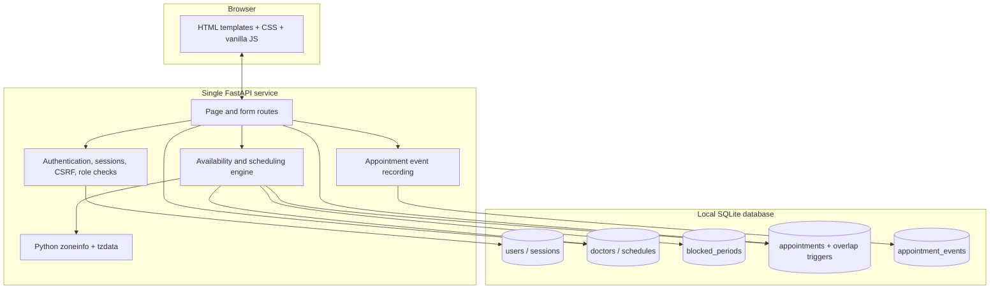

# SlotZero — System Architecture

## 1. Architecture summary

SlotZero is a single-service, server-rendered web application. FastAPI handles routing, request validation, authentication dependencies and form submissions. Jinja2 renders the UI. Vanilla JavaScript provides small browser interactions; CSS provides responsive styling. SQLite persists users, schedules, blocks, appointments, sessions and audit events.

## 2. Technology stack

| Layer | Technology | Current use |
|---|---|---|
| Language | Python | Application, scheduling, tests and scripts |
| Web framework | FastAPI | Routes, dependencies, form handling and health endpoint |
| Rendering | Jinja2 | Server-rendered HTML pages |
| Browser behaviour | Vanilla JavaScript | Confirm prompts, demo-login autofill, local clock |
| Styling | CSS | Responsive web interface |
| Persistence | SQLite | Single-file database, foreign keys and WAL mode |
| Time-zone support | `zoneinfo` + `tzdata` | IANA zones and daylight-saving handling |
| ASGI server | Uvicorn | Local/runtime serving |
| Testing | pytest + FastAPI TestClient/httpx | Core rules and route workflows |

## 3. Runtime components

### Presentation layer

- `templates/` contains the base shell, login/register, patient dashboard, doctor detail, doctor dashboard and reschedule pages.
- `static/styles.css` contains app styling.
- `static/app.js` handles confirmation prompts, demo credentials and the browser-local display clock using the user-selected IANA zone.

### Application layer (`app.py`)

- Environment loading and configuration.
- Database connection and transaction helpers.
- UTC conversion and strict local-time conversion.
- Password/session/CSRF helpers.
- Weekly schedule parser and slot generator.
- Patient, doctor and appointment routes.
- Audit event writes.

### Persistence layer

SQLite schema is initialized on startup. Foreign keys are enabled per connection. Connections use a 15-second busy timeout and WAL journal mode. Write operations needing serialization use `BEGIN IMMEDIATE`.

## 4. Main runtime flow

1. Browser requests a page.
2. App reads the opaque session cookie and looks up its token hash in `sessions`.
3. Route dependency requires authentication and, where applicable, the correct role.
4. Jinja2 renders data for the user's role.
5. For booking changes, CSRF is checked and the handler opens a write transaction.
6. Scheduling engine recomputes the slot from source data; the submitted UTC start is not trusted on its own.
7. SQLite uniqueness/trigger constraints provide an independent persistence guard.
8. Appointment and associated audit event are committed in the same transaction.
9. App redirects with a success/error notice.

## 5. Why the MVP uses server rendering

- One deployable service and one origin for page/form requests.
- No separate frontend runtime, bundler or CORS configuration.
- Smaller integration surface for a time-boxed challenge.
- Critical authorization and scheduling decisions remain server-side.

A JSON REST API and SPA are not part of the current MVP. FastAPI is used as the web framework, but the user workflow is predominantly HTML forms and redirects.

## 6. Concurrency design

Current MVP:

- Booking and rescheduling use `BEGIN IMMEDIATE` transactions.
- SQLite serializes writers for the database file.
- Application logic recalculates availability inside the transaction.
- Database triggers reject overlapping confirmed appointment inserts/updates.
- Unique `(patient_id, idempotency_key)` prevents duplicate submission retries.

This is a single-instance SQLite strategy. It is not a horizontally scaled architecture.

Recommended production migration:

- PostgreSQL as shared database.
- `tstzrange(start_utc, end_utc, '[)')` exclusion constraint by doctor ID for confirmed appointments.
- Transactional slot recheck and idempotency persistence.
- Managed database backups, monitoring and secret storage.

## 7. Deployment topology

Current: one Python web process + local SQLite file. For an online demo, the app can be hosted as one service if the platform offers persistent storage for SQLite. Ephemeral filesystems will lose the database on restart/redeploy; confirm disk persistence before deploying.

Production recommendation: stateless app instances + managed PostgreSQL + HTTPS + secure cookie + centralized secrets/logging.

## 8. Operational health

`GET /health` returns `{"status":"ok","service":"slotzero"}`. This is a process-level health response, not a deep database/readiness probe.

## 9. Architecture boundaries

- No admin UI.
- No external identity provider.
- No notifications, payments or calendar APIs.
- No medical-record storage.
- No public JSON business API beyond the basic health route.
