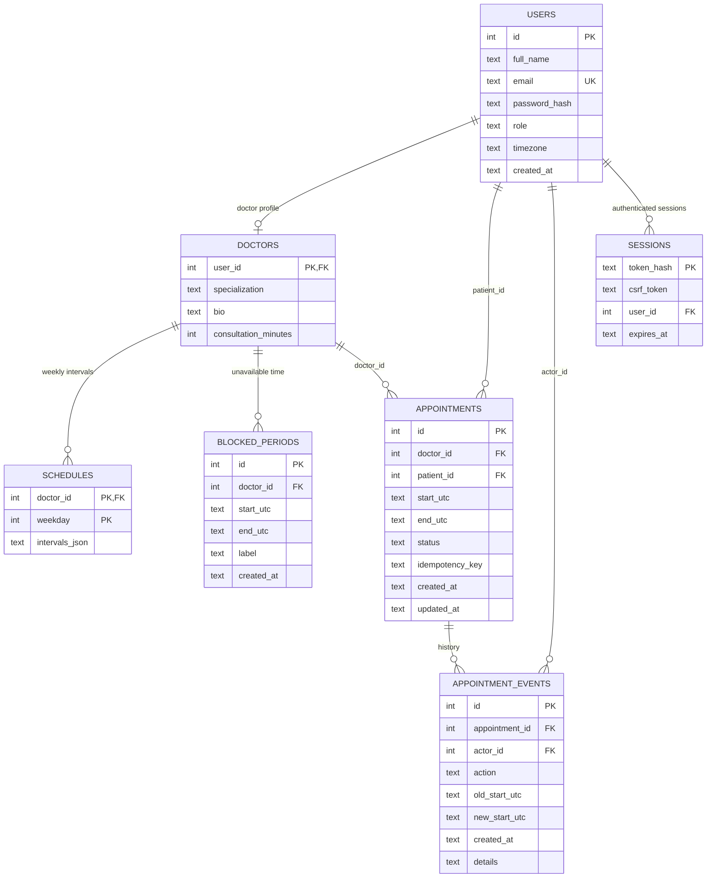
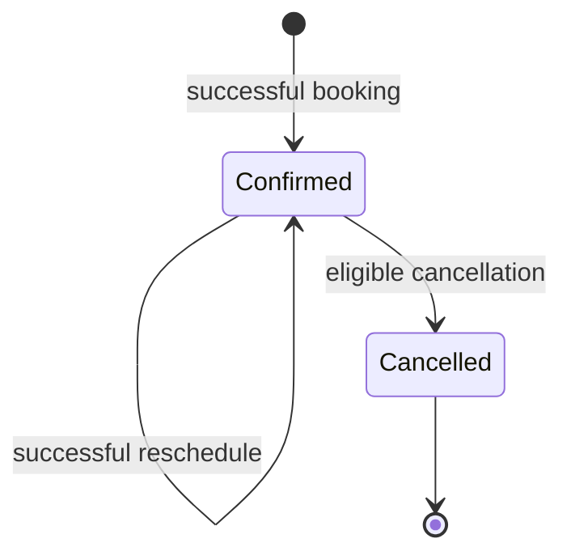

# SlotZero — Database Design

## 1. Overview

The current MVP uses SQLite. Table definitions are created from `app.py` during startup. Doctor IDs reference the corresponding `users.id` row.

## 2. Tables

### `users`

| Column | Purpose / constraint |
|---|---|
| `id` | Integer primary key |
| `full_name` | Required display name |
| `email` | Required, unique, case-insensitive |
| `password_hash` | Salted scrypt hash; plaintext is not stored |
| `role` | CHECK limited to `doctor` or `patient` |
| `timezone` | One of the three supported IANA names, validated by app workflows |
| `created_at` | UTC timestamp |

### `doctors`

| Column | Purpose / constraint |
|---|---|
| `user_id` | Primary key and FK to `users.id` |
| `specialization` | Required discovery/filter field |
| `bio` | Optional descriptive text (empty string default) |
| `consultation_minutes` | CHECK in 15, 30, 60; default 30 |

### `schedules`

| Column | Purpose / constraint |
|---|---|
| `doctor_id` | FK to doctor identity |
| `weekday` | 0 Monday through 6 Sunday |
| `intervals_json` | JSON array of local-time start/end pairs |
| Composite key | `(doctor_id, weekday)` |

An example stored weekday payload is `[ ["09:00", "12:00"], ["13:00", "17:00"] ]`. A schedule is recurring in the doctor's local time zone; generated appointment instants are not stored here.

### `blocked_periods`

Date-specific unavailable intervals stored as UTC instants. Each has a doctor ID, start/end, label and creation time. A block must have `start_utc < end_utc` and must not overlap a confirmed appointment.

### `appointments`

| Column | Purpose / constraint |
|---|---|
| `id` | Appointment primary key |
| `doctor_id` | Doctor user ID |
| `patient_id` | Patient user ID |
| `start_utc`, `end_utc` | Canonical UTC instants, ISO representation ending in `Z` |
| `status` | CHECK limited to `confirmed` or `cancelled` |
| `idempotency_key` | Submitted booking retry key |
| `created_at`, `updated_at` | UTC timestamps |
| Unique constraint | `(patient_id, idempotency_key)` |
| Check | `start_utc < end_utc` |

Indexes support doctor/time/status and patient/time lookups. Insert/update triggers reject overlapping confirmed appointments for the same doctor. The overlap rule allows exact adjacency.

### `appointment_events`

Append-style activity rows linked to appointment and actor. Current actions include `booked`, `cancelled` and `rescheduled`. Reschedule stores old/new UTC start instants. Since Phase 4, cancellation/reschedule `details` also contains JSON with full original UTC start/end and replacement start/end where applicable. Older text details remain valid and unchanged; no schema migration or historical end-time backfill was performed. Events are inserted in the same transaction as the associated state change.

### `sessions`

Stores the SHA-256 hash of the random session token, a CSRF token, user ID and expiry time. The raw session token is kept in an HttpOnly browser cookie and is not stored as-is in the database.

## 3. Relationships and ownership

- A doctor is a user with a matching row in `doctors`.
- A patient is a user whose role is `patient` and does not need a separate profile table.
- Each doctor owns their schedules, blocks and doctor-side appointment view.
- Each patient owns their appointments and patient-side history view.
- Each appointment can have multiple event rows.

## 4. Status lifecycle

No automated `completed` status exists. Past appointments remain recorded as `confirmed`, but upcoming lists and availability logic exclude past start times.

## 5. Data integrity rules

1. Foreign keys enabled per connection.
2. Email uniqueness is case-insensitive.
3. Role values are constrained by database CHECK.
4. Consultation length is constrained to 15/30/60 minutes.
5. Appointment start must precede end.
6. Confirmed appointment intervals cannot overlap for one doctor.
7. Patient/idempotency key pair must be unique.
8. Cancellation/rescheduling event write is transactional with the appointment change.

## 6. Production recommendations

- Migrate the appointment range guard to PostgreSQL exclusion constraints.
- Add migrations (e.g. Alembic) instead of relying only on `CREATE TABLE IF NOT EXISTS` initialization.
- Define retention/deletion policy for session and audit-event data.
- Add indexes based on production query plans and expected volume.
- Use database backups and a tested restore procedure.
