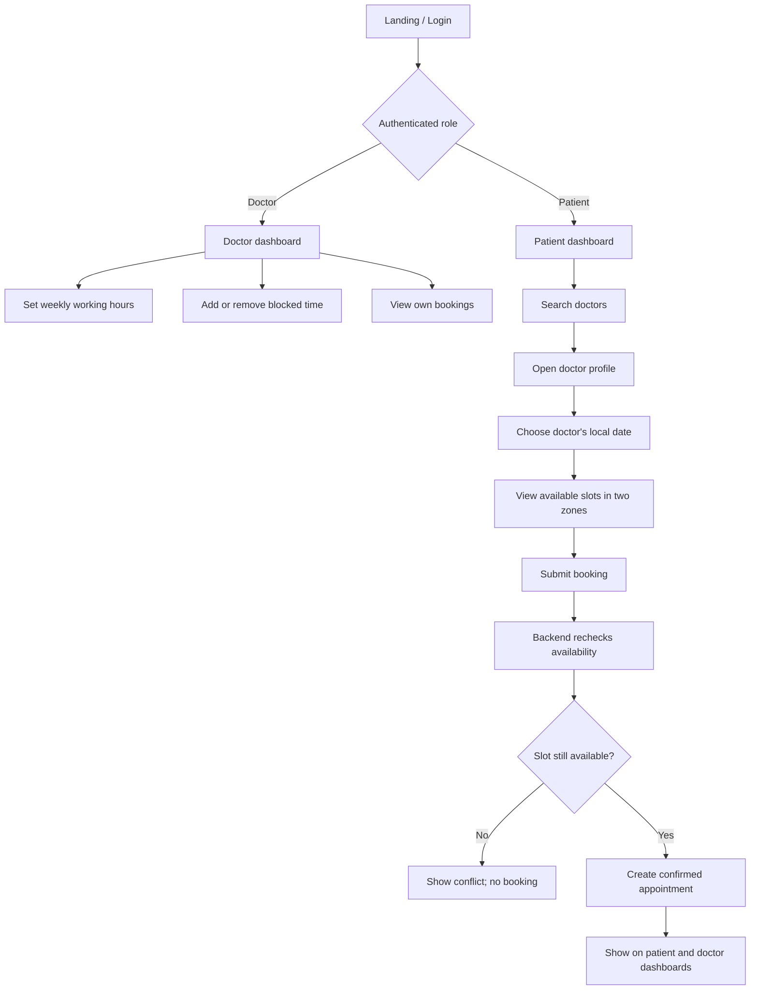
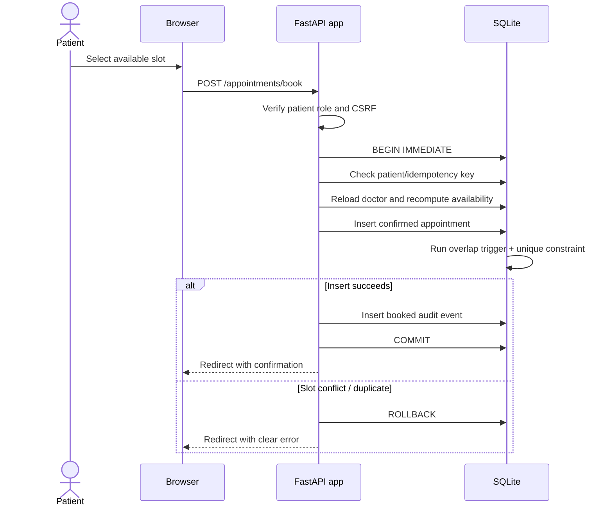
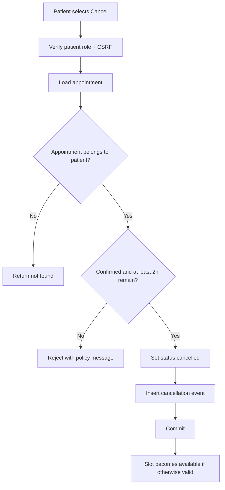
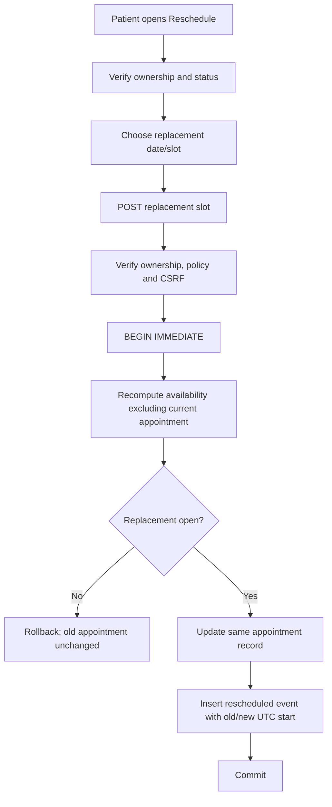

# SlotZero — User Flows and Use Cases

## 1. Actors

- **Doctor:** controls one doctor's schedule and views bookings assigned to that doctor.
- **Patient:** browses doctors and manages their own appointments.
- **Clinic/operator:** provisions doctor identities through a server-side script; no admin UI.
- **Scheduling engine:** validates time, schedule, blocks, existing bookings and database constraints.

## 2. High-level flow

## 3. Doctor workflow

1. Clinic/operator provisions doctor account.
2. Doctor signs in.
3. Doctor opens the doctor dashboard.
4. Doctor configures one line per weekday, e.g. `Mon: 09:00-12:00,13:00-17:00`.
5. Doctor selects 15, 30 or 60-minute consultation duration.
6. Server validates weekday labels, `HH:MM` intervals, non-overlap and end-after-start.
7. If a proposed schedule would exclude a future confirmed booking, the update is rejected.
8. Doctor may add a future blocked period in their own local time zone.
9. If a block overlaps a confirmed appointment, the request is rejected and the booking remains unchanged.
10. Doctor views appointments for a doctor-local calendar date and sees their own patient bookings.

## 4. Patient workflow

1. Patient registers or signs in.
2. Patient searches doctors by name and/or specialization.
3. Patient may filter by availability date.
4. Patient opens a doctor's profile.
5. Patient chooses a date on the doctor's local calendar.
6. Server generates slots dynamically.
7. Each slot displays patient-local and doctor-local time labels.
8. Patient submits a booking request with CSRF token, doctor ID, UTC slot start and idempotency key.
9. Server authenticates role, checks idempotency, reloads doctor data, regenerates slots and confirms that the requested instant remains available.
10. On success, appointment and `booked` event are committed together.
11. Patient sees the new appointment in their dashboard; doctor sees it on their dashboard.

## 5. Booking sequence

## 6. Cancellation workflow

## 7. Rescheduling workflow

## 8. Key use cases and alternate paths

| Use case | Success path | Alternate / failure path |
|---|---|---|
| Register patient | New patient account created | Duplicate email / invalid timezone / short password rejected |
| Login | User redirected to role dashboard | Generic incorrect-credentials message |
| Save schedule | Weekday intervals and duration persisted | Invalid ranges or conflict with active appointment rejected |
| Block time | Future block stored in UTC | Past, invalid DST or overlapping booking rejected |
| Book slot | Appointment + audit event committed | Stale slot, overlap or idempotency collision rejected |
| Cancel | Status becomes cancelled; audit event added | Wrong owner, already cancelled or inside cutoff rejected |
| Reschedule | Existing record updated and audit event added | Invalid/unavailable replacement leaves original unchanged |

## 9. Permission boundaries

- Patient: own upcoming appointments and history only; can cancel/reschedule only own appointments.
- Doctor: appointments for own doctor ID only; can modify own schedule and blocks only.
- A user changing an appointment ID in a URL must not gain access to another user's booking.
- A patient cannot access doctor-only routes; a doctor cannot access patient-only booking routes.
